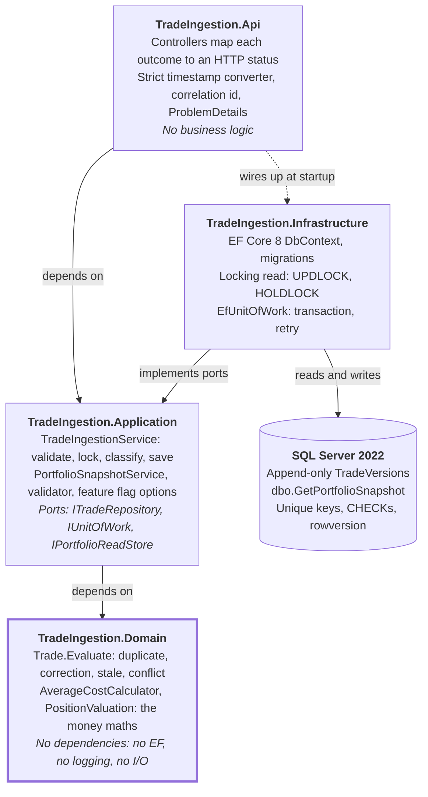

# Trade Ingestion Service: Build, Code and Trade-offs

## Overview

I built an ASP.NET Core 8 Web API on SQL Server that ingests trades exactly once and values a portfolio at any past date. It ignores duplicates, applies later corrections as new versions, ignores stale events, and keeps every version for audit. A set-based stored procedure, `dbo.GetPortfolioSnapshot`, produces the same numbers as the API, and a test proves they agree.

The hard part is not the CRUD. It is keeping the numbers right when upstream systems misbehave. I listed six ways the totals could go wrong and designed against each one:

| Risk | What the design does |
| --- | --- |
| The same trade arrives twice | A strict definition of "duplicate", enforced by a unique index |
| Corrections arrive out of order | An AsOf watermark; older events are ignored, never applied |
| Two requests race on one trade | A key-range lock on the ExternalRef, with database constraints behind it |
| An old version is counted in a snapshot | Exactly one version per trade is selected before any filtering |
| Silent rounding | `decimal` everywhere, fixed precisions, more than 6 decimal places rejected |
| Time-zone bugs | Timestamps without an offset are rejected; everything is stored as UTC |

Verified on Windows 11 against SQL Server 2022 (both re-run on 15 November 2026):

- **55 tests pass** (unit, end-to-end, concurrency, SQL parity, feature flag, API contract).
- **The demo script passes** all four assessment scenarios: new trade 201, duplicate 200, correction 200 (version 2), snapshot of 150 shares at 180.00 average cost, 27,900.00 market value and 900.00 unrealized P/L.

How to run it is in the [README](../README.md).

## Architecture

The solution is pragmatic Clean Architecture in four projects, with every dependency pointing inward toward a Domain that references nothing.



A trade submission flows top to bottom: the API deserialises and maps, the Application validates and opens a transaction, Infrastructure takes the lock, the Domain classifies, and Infrastructure saves. Infrastructure implements the Application's interfaces, so the use case never sees EF Core or SQL hints. The API references Infrastructure only to register it at startup.

## Code walkthrough

The business rules live in about 300 lines of dependency-free Domain code; everything else exists to feed them safely. I go from the inside out.

### Domain: the rules

**`Trade` (`Domain/Trades/Trade.cs`)** is the aggregate root for one ExternalRef. It holds the version list, the current version number, the AsOf watermark (`LatestAsOfUtc`) and a `RowVersion`. Its constructor is private, so a trade can only be born through `CreateNew`, which always writes version 1.

The heart of the service is `Evaluate`, a pure function that classifies a resubmission without changing anything:

```csharp
if (asOfUtc > LatestAsOfUtc)
    return details == CurrentVersion.Details ? NoEconomicChange : Correction;

if (asOfUtc == LatestAsOfUtc)
    return details == CurrentVersion.Details ? Duplicate : ConflictingPayload;

// Older than the watermark: a replay of a stored version is harmless, anything else is stale.
return _versions.Any(v => v.AsOfUtc == asOfUtc && v.Details == details) ? Duplicate : Stale;
```

The two mutating methods, `ApplyCorrection` and `AcknowledgeNoEconomicChange`, call `Evaluate` again first and throw if the decision does not match. The aggregate therefore cannot be pushed into an invalid state, even by a buggy caller. Every timestamp passed in must be `DateTimeKind.Utc`, or the method throws.

**`TradeDetails`** is a C# `record` holding the economic content: account, instrument, side, quantity, price, trade date. Record equality is what `Evaluate` compares. Because `decimal` equality is numeric, `185.40` equals `185.4`, so formatting differences are never mistaken for a correction. The constructor rejects zero or negative quantity and price; direction comes only from `Side`.

**`AverageCostCalculator`** groups effective trades by instrument and walks them in `(TradeDate, TradeId)` order. A BUY adds to the running quantity and to an open cost pool. A SELL reduces quantity only, so the average does not move. When the running quantity reaches zero or below, the pool resets. Closed positions are dropped; a short position gets a `null` average cost.

**`PositionValuation`** turns a position and a price into money. Market value and cost basis are each rounded to 2 dp, half away from zero, and P/L is their difference. The components therefore always reconcile to the cent. No price gives `MissingPrice` with `null` values, never zero.

### Application: the use case

**`TradeIngestionService.SubmitAsync`** runs in four steps:

1. **Validate** with `TradeSubmissionValidator`: trims and upper-cases identifiers, checks the ISIN check digit, rejects more than 6 decimal places and values beyond the column limits, converts AsOf to UTC. It returns *all* field errors at once, keyed by JSON field name.
2. **Resolve reference data**: look up the account and instrument, and check the symbol matches the ISIN. Unknown data returns 422; nothing is auto-created.
3. **Classify and persist in one transaction**: `ProcessAsync` takes the locking read, then either creates the trade or calls `Evaluate` and switches on the decision.
4. **Retry on a detected race**: if the database raises a `PersistenceConflictException`, the loop re-runs the transaction (up to `MaxConflictRetries`). The retry sees the winner's committed row and normally classifies itself as a duplicate.

The feature flag is read per request via `IOptionsMonitor`. With `EnableVersionedCorrections` off, any resubmission returns 409 `ExternalRefAlreadyExists`, and the decision the new logic would have taken is logged as a shadow event.

**Ports (`Application/Trades/Ports.cs`)** are deliberately narrow. `ITradeRepository` has exactly two methods, `GetForUpdateAsync` and `Add`, and its doc comment states the locking contract. Reads for the API (`ITradeHistoryReader`, `IPortfolioReadStore`) return projections, not entities.

**`PortfolioSnapshotService`** rejects future dates, computes the knowledge cutoff as the start of the next UTC day, loads the effective trades and prices, then runs the same `AverageCostCalculator` and `PositionValuation` as the domain tests use.

### Infrastructure: SQL Server

**`TradeRepository.GetForUpdateAsync`** is the single most important line of data access:

```csharp
var parameter = new SqlParameter("@externalRef", SqlDbType.VarChar, 64) { Value = externalRef };
_db.Trades.FromSqlRaw(
    "SELECT * FROM dbo.Trades WITH (UPDLOCK, HOLDLOCK) WHERE ExternalRef = @externalRef", parameter)
```

It throws if no transaction is open, because the lock is useless without one. `UPDLOCK` lets only one transaction hold the intent-to-modify lock. `HOLDLOCK` makes this one predicate serializable, so when the row does not exist yet SQL Server locks the *gap* in the unique index and a second first-time insert waits. The parameter is typed `varchar(64)` to match the column; an `nvarchar` parameter would force a conversion and turn the seek into a scan.

**`EfUnitOfWork`** wraps the operation in EF Core's retrying execution strategy, inside a READ COMMITTED transaction. It clears the change tracker on every attempt, so a deadlock retry starts clean. It translates SQL errors 2601 and 2627 (unique violations) and `DbUpdateConcurrencyException` (rowversion mismatch) into one `PersistenceConflictException` that the service understands.

**Migrations** are `InitialSchema` (tables, constraints, indexes) and `AddGetPortfolioSnapshotProcedure`, which runs the embedded `GetPortfolioSnapshot.sql` so the SQL file is the single source of truth. In Development, `DatabaseInitializer` applies migrations and runs the idempotent seed script at startup.

### API: the HTTP edge

- **`TradesController`** maps each outcome to a status code with one `switch`: 201 Created, 200 for duplicate / correction / stale, 400 validation, 422 reference data, 409 conflict. `GET /api/trades/{externalRef}` returns the full version history.
- **`AccountsController`** serves `GET /api/accounts/{accountId}/snapshot?date=`.
- **`RequireOffsetDateTimeOffsetConverter`** rejects any timestamp without `Z` or an explicit offset, before model binding.
- **`CorrelationIdMiddleware`** reads or generates `X-Correlation-ID`, validates it against a strict pattern to stop log injection, echoes it back and stores it on each version.
- **`GlobalExceptionHandler`** logs unexpected failures once and returns RFC 7807 ProblemDetails with no stack trace. Every error body carries `correlationId` and `traceId`.

### The stored procedure

`dbo.GetPortfolioSnapshot @AccountId, @SnapshotDate` is one set-based statement built from CTEs:

| CTE | What it does |
| --- | --- |
| `CandidateTrades` | Trades with any version on this account known before the cutoff (index range seek) |
| `RankedVersions` | All versions of those trades, on any account, numbered newest first with `ROW_NUMBER()` |
| `EffectiveTrades` | Rank 1 only, **then** filtered to this account and `TradeDate <= @SnapshotDate` |
| `SequencedTrades` | Running quantity per instrument via a windowed `SUM` |
| `HoldingPeriods` | `LastFlatSeq`: the last trade after which the position was flat or short |
| `Positions` / `CostedPositions` | Net quantity, and the average from BUYs after `LastFlatSeq` only |
| `ValuedPositions` | Latest price on or before the date via `OUTER APPLY TOP (1)`, then rounded money values |

It returns two result sets: one row per open position, and one summary row with totals, `UnpricedPositionCount` and `IsValuationComplete`. The cutoff is computed once into a variable so the `AsOfUtc` predicates stay index-seekable. Operands are cast to bounded precisions before multiplying, so SQL Server never truncates scale below the rounding point.

## Data model

Corrections never update a row; they append one. The audit trail is the data model itself, not a side log that can drift from it.

| Table | Role | Key columns and constraints |
| --- | --- | --- |
| `Trades` | Idempotency anchor: one row per ExternalRef | `ExternalRef varchar(64)` unique; `CurrentVersionNumber` (≥ 1); `LatestAsOfUtc`; `RowVersion rowversion` |
| `TradeVersions` | Append-only economic history | `(TradeId, VersionNumber)` unique; `(TradeId, AsOfUtc)` unique; `Side` in BUY/SELL; `Quantity decimal(18,6) > 0`; `Price decimal(19,6) > 0`; `AsOfUtc`, `ReceivedAtUtc`, `CorrelationId` |
| `Accounts` | Reference data | `AccountCode varchar(32)` unique |
| `Instruments` | Reference data | `Isin char(12)` unique; `Symbol` |
| `InstrumentPrices` | Daily closes | `(InstrumentId, PriceDate DESC)` unique, includes `ClosePrice`; `Currency = 'USD'` check |

The design rules behind those columns:

- **Every version records three things:** what the source said (`AsOfUtc`), when we learned it (`ReceivedAtUtc`), and which request delivered it (`CorrelationId`).
- **The two unique keys on `TradeVersions` guarantee a gapless, strictly ordered history**, even if application code were bypassed.
- **Exact money maths.** `decimal(18,6) × decimal(19,6)` fits exactly in `decimal(38,12)`. Money outputs are `decimal(24,2)`. There is no floating point anywhere.
- **UTC only.** Instants are `datetime2(7)` holding UTC. A model-wide EF value converter marks them `DateTimeKind.Utc` on read. Calendar dates are `date` / `DateOnly`.
- **`varchar` for ASCII identifiers.** It halves index size versus `nvarchar`, and keeps parameter types matched so lookups stay seekable.
- **Nothing cascades.** Foreign keys use `RESTRICT`, because deleting audit data should never happen as a side effect.

The supporting indexes are `IX_TradeVersions_Account_AsOf` (account, AsOf) including TradeId, which drives the snapshot's candidate search, and the covering `(TradeId, VersionNumber)` index, which arrives pre-sorted for `ROW_NUMBER()`. On a 220,000-version dataset the procedure's actual plan was seeks throughout: 314 logical reads, about 9 ms.

## Architecture trade-offs

Each choice below traded something away on purpose. The rule I applied throughout: correctness of the numbers first, then operability, then convenience.

### 1. Narrow ports instead of a generic repository or EF Core in the use case

**Chose:** purpose-built interfaces (`ITradeRepository` with `GetForUpdateAsync` and `Add`; separate read stores).

**Rejected:** a generic `IRepository<T>` hides exactly what matters here, the locking read. Calling EF Core directly from the Application layer would leak `WITH (UPDLOCK, HOLDLOCK)` into business code and make the use case untestable without SQL Server.

**Cost:** more interfaces to maintain, and some code to wire up. Worth it because the concurrency contract is now named in one place.

### 2. Rules in the aggregate, not the service

**Chose:** `Trade.Evaluate` decides; `TradeIngestionService` only orchestrates (about 60 lines).

**Rejected:** a service full of `if` statements. It would mix transaction handling with business rules and need a database to test them.

**Cost:** a slightly richer domain model than CRUD needs. In return every row of the decision table has a unit test that runs in milliseconds.

### 3. Append-only versions instead of temporal tables or in-place updates

**Chose:** explicit `TradeVersions` rows keyed by business time (`AsOf`).

**Rejected:** SQL Server temporal tables record *system* time, meaning when this database changed. Corrections are ordered by the source's AsOf, which can arrive out of order, and temporal tables cannot express "ignore this stale event". Updating in place with a separate audit log creates two sources of truth.

**Cost:** the snapshot query must pick one version per trade, which is the hardest query in the system. Storage grows with every correction.

### 4. A strict, explicit definition of "duplicate"

**Chose:** same ExternalRef + same AsOf + same economic content. Same AsOf with different content is a **409 conflict**. Older AsOf is **stale**.

**Rejected:** ExternalRef alone cannot tell a retry from a correction. A payload hash was rejected because `185.4` and `185.40` would hash differently. Silently letting the last write win on a same-AsOf contradiction is how books break.

**Cost:** conflicts need a human workflow that does not exist yet.

### 5. 200 for duplicates and stale events, not 4xx

**Chose:** 2xx with an explicit `outcome` field.

**Rejected:** 4xx would make normal at-least-once retries look like failures and page people.

**Cost:** clients must read the body to know what happened. Real anomalies (409, 422) are still 4xx.

### 6. A pessimistic key lock instead of SERIALIZABLE or optimistic-only

**Chose:** `UPDLOCK, HOLDLOCK` on the one ExternalRef lookup, inside a READ COMMITTED transaction, with unique constraints, rowversion and a bounded retry as backstops.

**Rejected:** a SERIALIZABLE transaction would range-lock every read, including reference data, and raise deadlock risk. Optimistic-only (let the unique constraint catch the race) turns every race into an exception path.

**Cost:** concurrent submissions for the *same* ExternalRef queue behind each other. Different ExternalRefs lock different keys and do not block.

### 7. Holding-period average cost instead of a strict moving average

**Chose:** the average resets each time a position goes flat; within a holding period it is the average of all BUYs.

**Rejected:** a strict moving average depends on trade order and needs a recursive calculation in SQL, and matching C# rounding step by step is fragile. My method uses ordinary window functions and gives exact SQL/C# parity.

**Cost:** the numbers differ in one pattern. `BUY 100 @ 10, SELL 50, BUY 50 @ 20` gives **13.33** under my method and **15.00** under a strict moving average. This is the biggest simplification in the solution, and it is documented. The production fix is a persisted position ledger.

### 8. Snapshot computed on read

**Chose:** calculate positions from versions at request time, in both C# and SQL.

**Rejected:** a persisted positions table, for now. It adds a second source of truth that must be kept in sync on every correction, including back-dated ones.

**Cost:** end-of-day runs across thousands of accounts would repeat work. The measured cost per account is small (about 9 ms at 220,000 versions).

### 9. The same rules in C# and SQL

**Chose:** implement the calculation twice and prove they agree with a parity test on four dates.

**Rejected:** SQL only (harder to unit test), or C# only (the brief asked for a stored procedure, and reporting tools need one).

**Cost:** two implementations to change together. The parity test makes drift fail the build.

### 10. Real SQL Server in tests instead of SQLite or in-memory

**Chose:** integration tests on SQL Server, a fresh database per test class, created through the real migrations.

**Rejected:** SQLite has no key-range locks, no rowversion, different decimal behaviour and no T-SQL. The EF in-memory provider has no transactions or constraints. Tests on either would pass while production double counts.

**Cost:** tests need a SQL Server and take a few seconds rather than milliseconds.

### 11. Hand-written validation, no MediatR

**Chose:** one static validator and a direct service call.

**Rejected:** FluentValidation and MediatR. With one command they add dependencies and indirection without benefit.

**Cost:** if commands multiply, these would be worth revisiting.

### 12. A feature flag with shadow mode

**Chose:** `EnableVersionedCorrections`. Off means legacy first-write-wins, but the new decision is logged for every resubmission.

**Rejected:** a big-bang switch. Shadow logs let operations check, against real traffic, how many resubmissions would have become corrections before enabling.

**Cost:** a legacy code branch to delete after rollout. The database invariants hold in both modes, so rollback is a configuration change.

## Testing and verification

All 55 xUnit tests pass against SQL Server 2022, and the demo script passes every check. The tests target the risks, not the lines of code.

| Suite | Tests | What it proves |
| --- | --- | --- |
| `TradeAggregateTests` | 8 | Every row of the duplicate / correction / stale / conflict decision table |
| `AverageCostCalculatorTests` | 9 | Weighting, sells, reset when flat, short positions, ordering, rounding mode |
| `PositionValuationTests` | 4 | Money rounding matches SQL `ROUND`; missing price gives nulls, not zeros |
| `TradeSubmissionValidatorTests` | 12 | Normalisation, UTC conversion, all errors returned at once, decimal places, ISIN check digit |
| `TradeLifecycleEndToEndTests` | end-to-end | Over HTTP: new 201, duplicate 200, correction to v2, snapshot 150 / 180.00 / 27,900.00 / 900.00, v1 preserved, stored procedure agrees, day before is empty |
| `ConcurrencyTests` | concurrency | 25 parallel identical submissions give 1 Created and 1 row; 10 corrections fired in reverse order end on the latest AsOf with no gaps |
| `SnapshotSqlParityTests` | parity | API equals stored procedure on 4 dates; late correction; the "moved account" double-count case; `Indexes.sql` cannot drift from the schema |
| `FeatureFlagTests` | flag | Legacy mode returns 409 and never applies a resubmission |
| `ApiBehaviourTests` | contract | Stale, conflict, offset-less timestamp, 400 with all errors, 422, malformed JSON, correlation id round trip, future date, 404 |

Each integration test class creates its own database (`TradeIngestionTests_<guid>`) through the API's real startup path, so the migrations and seed script are tested too. Classes run in parallel on separate databases and drop them afterwards.

If no SQL Server is reachable, the integration tests **fail** with instructions; they are never silently skipped. Unit tests run with no database (`dotnet test --filter "FullyQualifiedName~Unit"`).

One gap to be upfront about: the `docker compose` path was never run end to end. Everything was verified against a local SQL Server 2022 with Windows authentication.

## Deliberately left out, and what comes next

I kept the scope to what the brief needed and made each omission visible rather than silent.

| Left out | Why | Path forward |
| --- | --- | --- |
| Cancellations | Not in the brief | A version with `Status = Cancelled`, selected by the same `ROW_NUMBER()` logic |
| Fees, realised P/L, cash, corporate actions | Out of scope | Lifecycle fields, and an adjustment-factor table for splits |
| Multi-currency | No FX data provided | A `CHECK (Currency = 'USD')` enforces it today; add an FX rates table and expose the FX date like `priceDate` |
| Auto-creating accounts or instruments | Reference data belongs to another system | Unknown data is rejected with 422 |
| Authentication, rate limiting, HTTPS termination | Belongs at the gateway | OAuth2/OIDC with per-account authorisation, mTLS for system-to-system |
| Message queue and outbox | Not needed to prove the core logic | Kafka or Service Bus input with the same idempotency; an outbox row per version for downstream events |
| Persisted position ledger | Second source of truth to keep in sync | Updated from the outbox; enables a true moving average and fast end-of-day reports |
| Metrics and tracing | Logging covers the brief | OpenTelemetry counters per outcome; conflict and stale rates measure upstream data quality |

Two smaller known limitations: trades on the same day are ordered by first-seen `TradeId`, because no execution timestamp is supplied, and prices carry forward indefinitely, with only `priceDate` showing their age.

The full rationale, including rollout steps and how this would fit a .NET Framework 4.8 estate, is in [SOLUTION.md](../SOLUTION.md).
